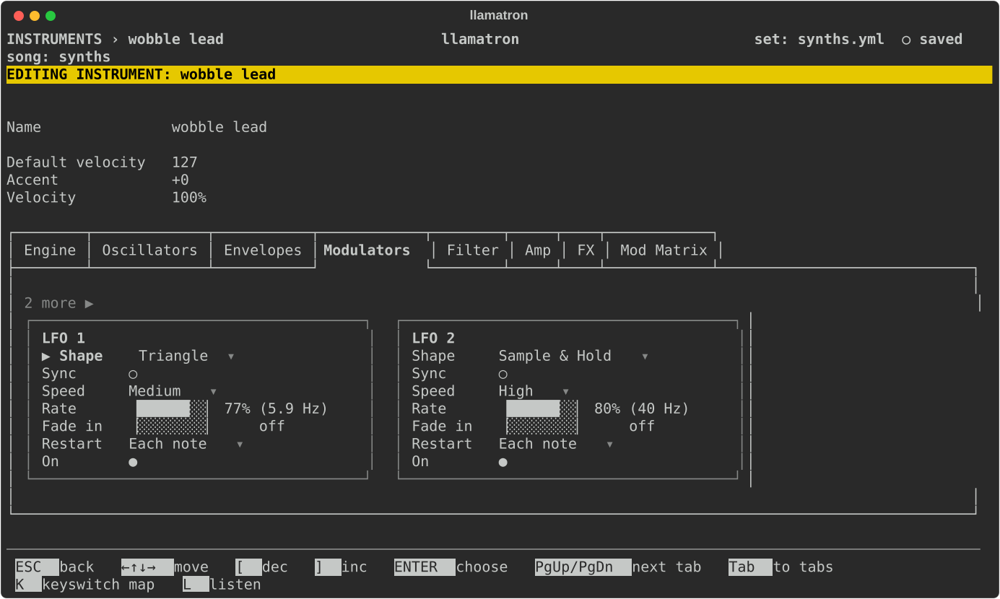

# LFOs

An LFO, a low-frequency oscillator, is a slow or fast wobble, as a player's
hand shaking the pitch for vibrato or turning a knob back and forth. The
Modulators tab holds four modulators, Mod 1 to Mod 4, each an LFO or a
[Snail](#snail), chosen by its Type. What each one moves is set in the [Mod
Matrix](MOD_MATRIX.md). Each is on unless switched off, its On switch at the
foot of its column, so that a route to it is heard at once; one that no route
reads costs nothing.

Shape is Sine, Triangle, Saw up, Saw down, Square, Sample & Hold, a new
random value each cycle, or Smooth random, a new random value each cycle glided
to rather than stepped, for a wandering drift where Sample & Hold jumps. Speed chooses how fast a span the Rate covers, as the
range switch of a modular synthesizer's LFO does, and Rate, from 0 to 100%,
sweeps across it, each step a like change in octaves, its hertz shown beside
it, such as `74% (5.0 Hz)`:

| Speed | Rate's span | For |
| --- | --- | --- |
| Low | 0.01 Hz to 1 Hz | slow sweeps, a cycle of up to 100 seconds |
| Medium | 0.1 Hz to 20 Hz | vibrato, wobble and tremolo |
| High | 1 Hz to 100 Hz | trills, flutter, wobble turning to buzz |
| Very High | 20 Hz to 5 kHz | audio rate, for analog-style FM |

At Very High the LFO is fast enough to be heard as a tone of its own, so an
LFO routed to the pitch through the Mod Matrix makes the bright, clangorous
sidebands of analog FM, and to the cutoff or the amp, filter FM and AM. Its
Key switch, shown only at Very High, makes the Rate a ratio to each note's own
frequency, from 1:4 to 8:1, so that the modulation stays in tune across the
keyboard as an FM modulator does: 1:1 and 2:1 sound harmonic, 3:2 hollow, odd
ratios metallic. With Key off any rate can be set. At audio rate the saws and
the square are band-limited so that they do not alias, and however far an LFO
moves the pitch, no oscillator plays below MIDI's lowest note or above about
20 kHz.

Restart says when a modulator's cycle starts again. On play, the default,
starts it from zero whenever playback starts from silence, then lets it run
underneath everything until playback stops, even through scenes that do not
use it; launching a clip or a scene while the song plays never restarts it.
Each note starts it again with every note, so that every note's vibrato
starts the same way. Each scene starts it again whenever a scene starts, so
that a slow sweep lines up with each scene. Never keeps its place when
playback stops and goes on from there when it starts again. While nothing
plays, every modulator stands still and costs nothing.

## Sync and Fade In

Sync, off unless switched on, sets the Rate as a length of the song's beat
instead of a Speed: from 16 bars, a slow swell over a whole section, down to
1/64 of a note, with a dotted and a triplet value for each note length, such as
`1/8 dotted`, so that a wobble or a tremolo stays in time with the song through
every change of tempo and every tempo ramp. A bar here is four quarter notes.

Fade in, from off to 10 seconds, raises the LFO's depth after each note starts,
as a violinist's vibrato grows into a held note: each note fades in from its
own start, so that short notes stay plain and long ones bloom.

## Snail

A Snail drifts: three slow wanderers that never repeat, for a pad whose
brightness opens and closes over half a minute, never twice the same way, or a
delay that comes and goes over a whole song. Each of its three circuits, Slow,
Slower and Slowest, wanders around two places and switches between them at
times no one can predict, Slow about every 20 seconds, Slower about every 2
minutes and Slowest about every 30 minutes. Nothing starts a Snail again: it
goes on drifting from wherever it stands each time playback starts, as a
circuit left switched on would, while a WAV export always starts it from the
same place, so that an export sounds the same every time. Each instrument's
Snails wander paths of their own.

Each circuit gives three outputs to the Mod Matrix, X, Y and Z, each from -100%
to +100%: X its first stage, which bends sharply at each switch, Y its last
stage, the smoothest, and Z the same path as Y upside down, from another stage
of the circuit. For Mod 2 they are listed as
`Mod 2 / Slow X` to `Mod 2 / Slowest Z`.

| Setting | Range | What it does |
| --- | --- | --- |
| Slow | -100% to +100% (+0%) | how long Slow lingers on each side: toward +100%, its Y stays above the middle longer, at +0% the circuit as built |
| Slower | -100% to +100% (+0%) | the same for Slower |
| On | on or off | whether the Snail runs |

Slowest has no setting of its own. Slow and Slower are also Mod Matrix
destinations, `Mod 2 / Slow` and `Mod 2 / Slower`, which every source can move:
an LFO, a Snail or a MIDI CC at once, and a note's own sources, such as its
envelopes and Velocity, from the newest note, since a Snail belongs to the
whole instrument.

Each circuit is a slow chaotic electronic circuit, two integrators, an inverter
and a switch, modelled part for part with its op-amps' limits, stepped on a
clock of its own so that its path never depends on the sample rate.

## How the LFOs Are Built

An instrument's LFOs are shared by all its notes, as on most synthesizers,
except a Key LFO, which each note runs at its own ratio to its own pitch.
Each LFO keeps one running count of the cycles it has turned, and the shapes
are read straight from where in its cycle it is: a sine from the angle, a
triangle and saws from straight lines, a square from which half of the cycle
it is in. The values for a whole chunk of sound are worked out once, before
any voice is played, so that four LFOs cost the same however many notes read
them.

Sample & Hold doesn't draw a random number as it goes: when the instrument is
compiled, a long row of random values is drawn from a fixed seed, and each
cycle of the LFO reads the next one. So a Sample & Hold line is random to the
ear and yet the same at every playing, live and in a WAV export, and a
restart brings it back to the same place in the row.
