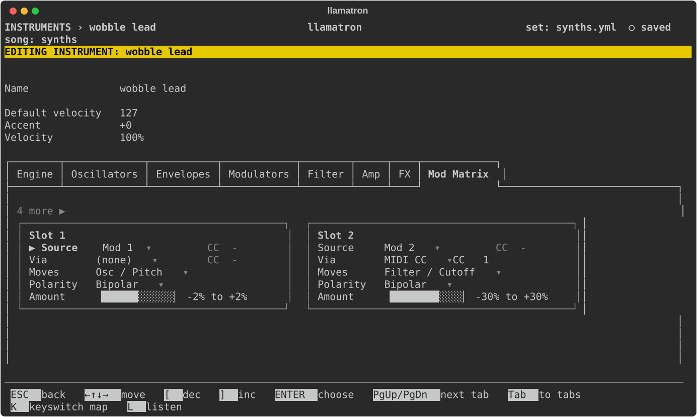

# Mod Matrix

The Mod Matrix says what moves what, as the patch cables of a modular
synthesizer do, laid out as a table. Its six slots are on the Mod Matrix tab.

Each slot has a Source: an envelope, an LFO, an output of a
[Snail](LFOS.md#snail), the note's Velocity, or Per Note
S&H, a random value drawn as each note starts and held for the whole note, a
sample and hold built in; or Osc 1, the note's own oscillator (Osc 1 to Osc 3
on Asheville, one for each), which moves at audio rate: Osc 1 to Pitch is the
bright, clangorous feedback FM of an oscillator modulating itself, Osc 1 to
Cutoff the growl of audio-rate filter FM, and Osc 1 to Amp a ring of AM, on
any engine, even one that never had FM. An
LFO at Very High speed routed to Pitch is the same analog-style FM from a
second source ([LFOs](LFOS.md)). A Via scales the source by a second one, so
that, for instance, an LFO moves the cutoff only as far as the note is loud;
Per Note S&H is a source only, never a Via.
Moves is what it moves, Pitch, Pulse width, Detune and Fine (every
oscillator's tuning, by up to a semitone and a tenth of one), SID interval (how far the
SID's second oscillator stands from the note, for sweeping a sync lead), Cutoff,
Resonance, Amp or an LFO's rate,
and Amount how far, either way, as a share of what it moves. Mod 1 to Pitch, with an LFO in Mod 1, is
vibrato, with a Square shape and a large Amount a chip trill; Velocity to
Cutoff makes harder notes brighter; Per Note S&H to Detune makes each note a little
different.

Polarity says how the route reads a source that swings both ways, as an LFO
does. Bipolar, the default, moves what it moves from minus the Amount to plus
it, as a vibrato bends the pitch either side of the note. Unipolar moves it
from nothing to the Amount, so that an LFO on the Cutoff only ever opens the
filter from where it is set, never closes it. The Amount shows the range it
gives, such as `-30% to +30%` or `0% to +30%`; a source that only rises, such
as an envelope or Velocity, always moves from nothing to the Amount.

## LFO Rates

An LFO can speed up and slow down another, the way a player turns a
vibrato's speed knob while holding a note. Moves also offers Mod 1 / Rate to
Mod 4 / Rate. A slot whose Source is an LFO moves that LFO's rate by up to two
octaves either way at its full Amount: 50% doubles it at the source's top and
halves it at its bottom. Mod 2, a slow sine, into Mod 1 / Rate makes Mod 1's
vibrato quicken and relax in waves; an LFO into its own rate bends its shape,
racing through one half of its cycle and lingering in the other. Unipolar
only ever speeds the rate up. A Via scales the route as elsewhere, by another
LFO. A Snail's A and B, `Mod 2 / A` and `Mod 2 / B` among the
destinations while Mod 2 holds a Snail, take every source
([Snail](LFOS.md#snail)). The LFOs belong to the whole instrument, not to a note,
so only an LFO moves a rate: a slot reading an envelope, Velocity, Per Note S&H, an oscillator
or a CC into a rate, or scaling it by one of them, moves nothing. An LFO
following the key keeps its ratio to the note and is not moved.

## MIDI CC Sources

A knob on a controller, or a CC row of a pattern, can move the sound through
the matrix. The last entry of the Source and Via pickers is `MIDI CC`. Beside
each Source and Via stands a CC field: a dash where the slot reads anything
else, and the CC's number, from 0 to 127, where it reads a MIDI CC, 74 at
first. Right moves the cursor onto the number, where `[` and `]` step it and
ENTER types it. The CC's value, from 0 to 127, moves its destination from
nothing to the slot's full Amount. A track's CC rows reach its built-in
instrument as they reach any MIDI device, so a pattern whose CC row the track
sends as CC 74, with a slot reading CC 74 into Cutoff, opens and closes the
filter as it plays, live and in a WAV export alike. A CC starts at 0 until its
first message comes.

## How the Matrix Is Built

The routes every synth needs are wired in outside the matrix, as a
semi-modular synth's normalled connections are: Env 1 to the amp, Env 2 to the
cutoff through the filter's Env amount, and the key to the cutoff through Key
track. Env 3 is wired to nothing, so that it is free for any use: a route
from Env 3 to Pitch gives a pitch envelope. All six slots stay free for
movement of your own.

When an instrument is compiled, empty slots and slots of no amount are left
out, and each route keeps its source, its via, its destination and how far it
moves at the source's full value. Each sample, a voice reads only the sources
some route uses, multiplies each by its via, and adds what every route gives
each destination together, so that two routes to the cutoff add up. Pitch is
moved in semitones and the cutoff in octaves, so that a route sounds as wide
at a high note as at a low one.

## Planned

The agreed design has eight slots, the first two Gate to Env 1 and Gate to Env
2 by default, and each amount shown in its destination's own unit.
