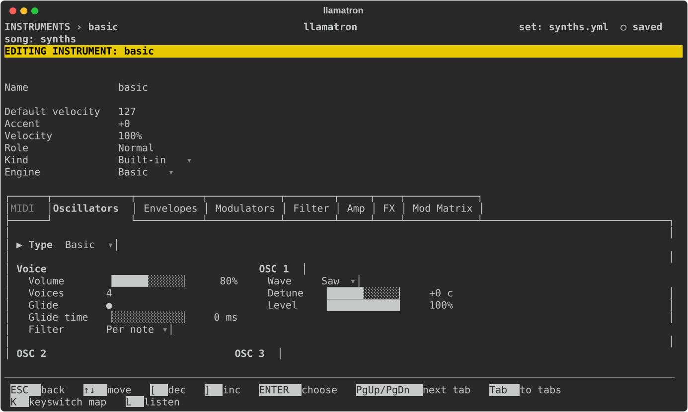
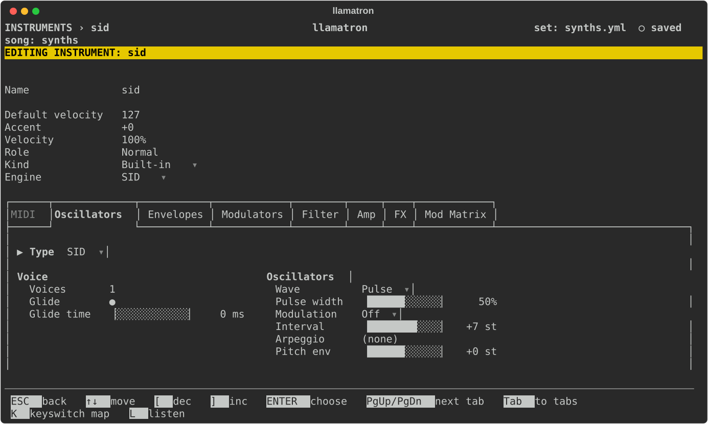
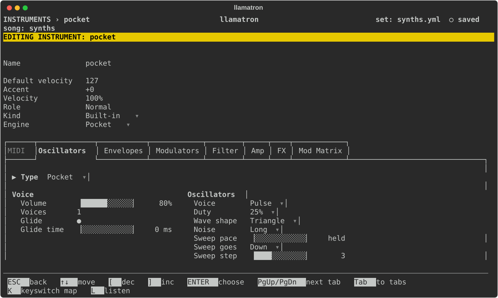
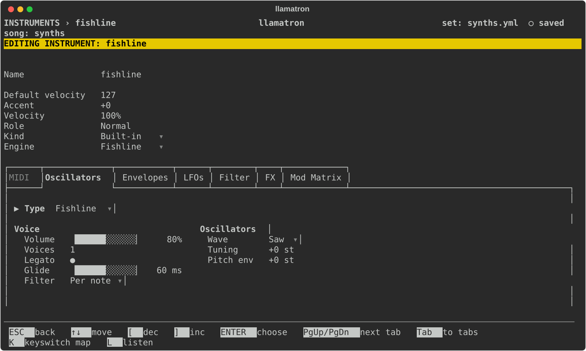
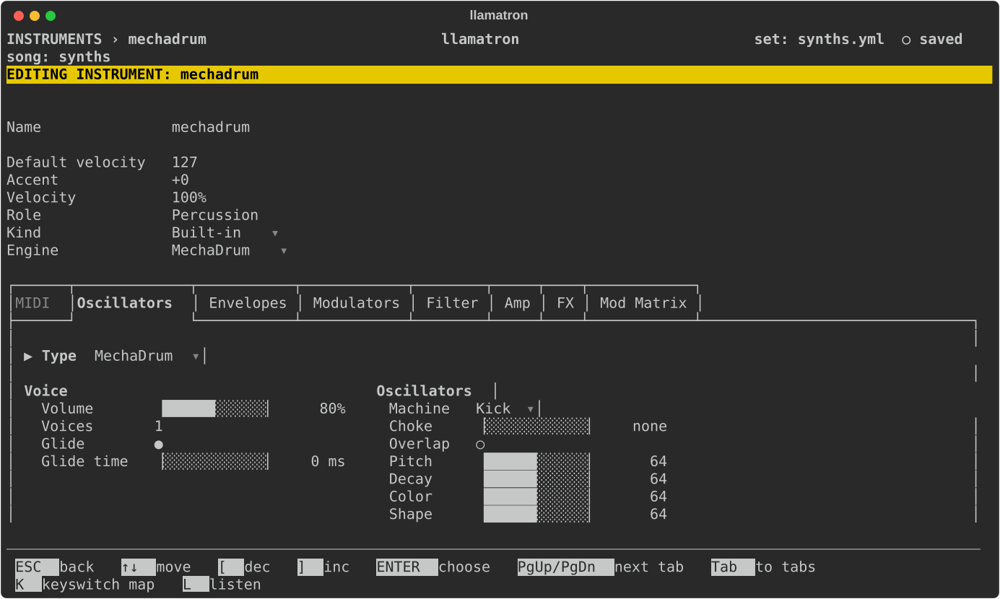

# Oscillators

The Oscillators tab, the first of a built-in instrument's sound, holds the raw
tone: what the filter, the envelopes and the effects then shape. It is where
the engines differ most, and its Type chooses which oscillator it holds, so an
engine's oscillator can be given to another engine's envelopes and filter.
Each engine's page says how its oscillator is made.

Its Voice column, at the left, is the same for every engine, and is described
at the end of this page.

## Basic

[Basic](engines/BASIC.md) describes it.

## SID

[SID](engines/SID.md) describes it.

## Pocket

[Pocket](engines/POCKET.md) describes it.

## Fishline

[Fishline](engines/FISHLINE.md) describes it.

## MechaDrum

[MechaDrum](engines/MECHADRUM.md) describes it.

## Voice Column

The Oscillators tab's Voice column holds what is the whole instrument's:
Volume; Voices, how many notes sound at once; Legato, where a note that starts
while another is held slides to it without starting its envelopes again, as an
acid line's tied steps do; Glide, how long a note takes to slide; and Filter,
Per note, each note its own filter as on a polysynth, or Shared, one filter
moved by the newest note, as on a paraphonic synth.
