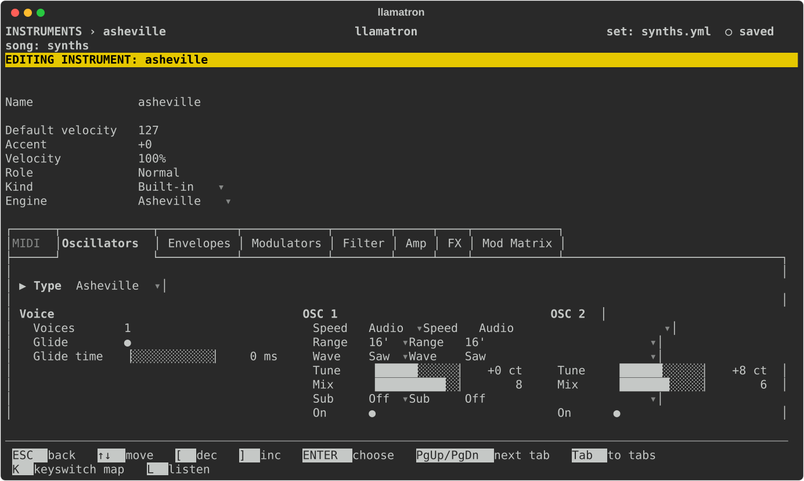

# Asheville

Asheville is the analog mono synth of the 1970s, three oscillators into a
ladder filter: the fat, beating lead and bass of the classic three-oscillator
monosynth. Its sound is in its three free-running oscillators drifting against
each other, a mixer that growls as it is turned up, and the ladder filter that
follows. It plays one voice, sliding on glided steps; with Voices raised it
plays chords too, each note its own three oscillators, through a filter of its
own or one shared, as the polyphonic analogs of the same years did.

## Oscillators Tab

Each of the three oscillators has its own column:

| Setting | Choices | What it does |
| --- | --- | --- |
| Speed | Audio, Low, Medium, High | Audio plays the note at its Range; Low, Medium and High run it at its Rate whatever the note, as an LFO's Speed does, for the oscillator as a slow modulator through the Mod Matrix |
| Rate | 0 to 100%, its hertz shown | At Low, Medium or High, in the Range's place, how fast it runs across its Speed's span, as an LFO's Rate |
| Range | 32', 16', 8', 4', 2' (Osc 3 also LO) | The footage: 8' plays the note, each halving of the pipe an octave up; LO, on Osc 3, four octaves under, for an LFO through the Mod Matrix |
| Wave | Triangle, Shark tooth, Saw, Square, Wide pulse, Narrow pulse (Osc 3 Reverse saw in the Shark tooth's place) | The panel's six waves, on the Classic model |
| Shape | 0 to 100% | On the Continuous model, one sweep from triangle at 0 through saw and square to a narrow pulse at 100%, in the Wave's place |
| Tune | −2400 to +2400 cents | The oscillator's tuning against the note, a few cents for the beating that makes it fat, a fifth or an octave for a chord on one key |
| Mix | 0 to 10 | Its level in the mixer |
| Sub | Off, −1 octave, −2 octaves | A square under the oscillator, one or two octaves down, for weight; off unless chosen |
| On | on or off | Whether it sounds; switched off, it still runs, so that the Mod Matrix can read it as a source |

And the panel's own settings:

| Setting | Choices | What it does |
| --- | --- | --- |
| Model | Classic, Continuous | The six switched waves, or one Shape to sweep, as the later models have |
| Character | Warm, Cold Start, Worn | Warm is settled; Cold Start wanders further for its first half minute, as if just switched on; Worn beats more between its oscillators and slips flat high up |
| Noise | 0 to 10 | White noise in the mixer, for breath, wind and the hiss under a snare-like hit |
| Ring | 0 to 10 | A ring modulator, Osc 1 times Osc 2, mixed in at this level: the clangorous, bell-like sum and difference tones; heard whether or not the two sound themselves |
| Snap | on or off | Pulls each Tune toward unison, fifths and octaves, so that a chord tuned by ear lands in tune |
| Drift | 0 to 10 | How far each oscillator's tuning wanders, slowly and in its own way |
| Feedback | on or off, with its amount 0 to 10 | Loops the mixer's output back into it, the classic patch of the output into the external input, for a thicker, overdriven growl |
| Pitch env | −48 to +48 semitones | How far Env 3 moves the pitch |

Each oscillator is also a source in the Mod Matrix, Osc 1, Osc 2 and Osc 3,
sounding or switched off: Osc 3 at LO, switched off and routed to the pitch, is
the classic vibrato and trill; Osc 2 at audio rate routed to Osc 1's pitch, or
to the cutoff, is analog-style FM. Glide, Glide time and Voices are on the
Engine tab every engine shares; the
ladder filter is on the Filter tab, its loudness and filter contours on the
Envelopes tab.

## How Asheville Is Built

Each wave is worked out from its oscillator's place in its cycle, every
sample, and its jumps are smoothed by a polyBLEP, so that the waves stay bright
and clean wherever the pitch goes, under glide, vibrato and audio-rate FM
alike. The oscillators keep running between notes, each starting at a place of
its own, as free-running oscillators do, so that no two notes start alike. The
mixer saturates softly, so three oscillators at full overload it, and Feedback
sends its last output back into it.

[Synths](../../SYNTHS.md) lists every engine. [Credits](../../CREDITS.md)
names the open work it follows.
