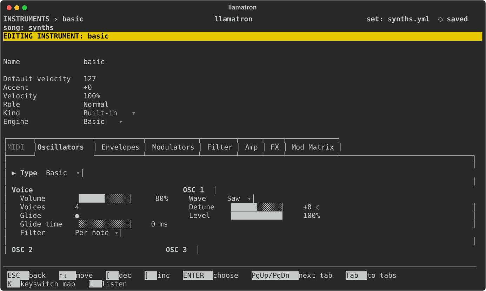

# Basic

Basic is the plainest of the synths: up to three oscillators, each a Square,
Saw, Sine, Triangle or Pulse wave, or Off, given a Detune in cents and a
Level, through snappy ADSR envelopes and a ladder filter each note's own. Two
saws detuned a little apart are the classic thick lead; a square an octave
under a saw is a bass with weight.

## How Basic Is Built

Each oscillator works out its wave every sample from where it is in its
cycle. A naive saw or square holds harmonics far above what a sample rate can
carry, and they fold back down as harsh, out-of-tune whistles; so each jump of
the saw, the square and the pulse is smoothed over the four samples around it
by a polyBLEP, a small correction that takes away the folding, and each corner
of the triangle is rounded over the same four samples by its partner, a
polyBLAMP, while the sine needs nothing. The waves stay full and bright at every
pitch, with no octave tables and no change of tone from one octave to the
next, and they stay clean wherever the pitch goes, under glide, vibrato and
audio-rate FM. The pulse's width can move smoothly, as the Mod Matrix's Pulse
width moves it.

The read speeds of the three oscillators are worked out from the pitch and the
detune once, and again only when something moves the pitch, so that a held
note costs a few operations per oscillator per sample. Detune
spreads by the Mod Matrix's Detune, so that a route can widen or narrow the
chorus of two oscillators.
