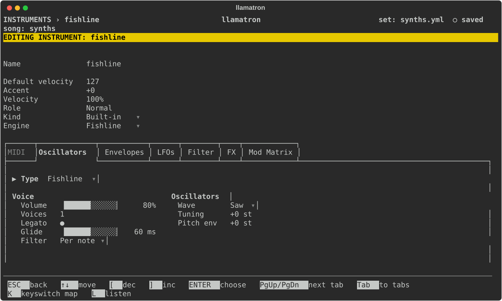

# Fishline

Fishline is the acid bass: one voice of a saw, or the square a transistor
shapes from it, through the [acid gate](../ENVELOPES.md#acid-gate) with its
accents, a short sweep into the squelchy [diode filter](../FILTERS.md#diode)
and a pedal's gentle [drive](../EFFECTS.md#drive), sliding legato from note to
note. A note at the acid gate's Accent at velocity or louder is accented: its
filter opens further and falls fast, it swells for a moment, and a run of
accents climbs higher.

## How Fishline Is Built

The saw is read from band-limited wavetables, as Basic's are. The square is
made from the saw as the circuit makes it: one saw less another half a cycle
on gives a square, and that square is pushed through a soft saturating curve,
the transistor's, and scaled back to full, so that its corners are rounded as
the original's are. Tuning shifts the whole voice by semitones.

Fishline's character is in the parts its engine chooses around that
oscillator: the acid gate's accent and its charging capacitor, the diode
filter's resonance stopping short of ringing, Legato on and a Glide, so that
tied steps slide without starting the envelopes again. Any of those can be
swapped, and any of them can be given to another engine.
