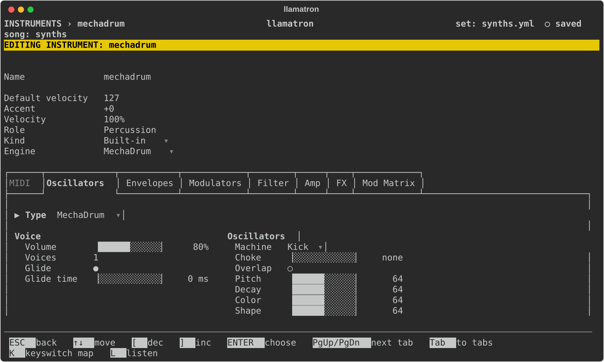

# MechaDrum

MechaDrum is a drum machine of ten drums, chosen by its Machine: Kick, Hard
Kick, Synth Kick, Snare, Clap, Rim, Hats, Cowbell, Acoustic Tom and Karplus
Drum. Each is shaped by the same five knobs, Pitch, Decay, Color, Shape and
Sweep, which each drum reads in its own way. The note tunes the drum in half
steps from middle C, and a harder hit is brighter. A drum cuts its own last
hit unless Overlap is on, and drums of one Choke group cut each other, as a
closed hat cuts an open one. Only a percussion instrument offers it.

## How MechaDrum Is Built

A hit isn't played sample by sample as a note is: when its note arrives, the
whole hit is rendered at once, on the thread that reads the notes, never in
the audio callback, and kept, so that the next hit of the same drum at the
same settings is replayed. Its noise comes from a random source seeded by what
the hit is, so that a replay and a WAV export match to the sample. Every hit
ends alike: a high-pass filter takes out any offset, a fade ends it where it
falls silent, and a gain sets its loudest moment to the same peak.

The recipes follow the circuits of the drum machines that defined electronic
drums:

- **Kick**: a sine whose pitch starts high and sweeps down, by Sweep, decaying
  by Decay; Color adds a click, a short burst of filtered noise and a couple
  of harmonics, and Shape drives it into a soft clipper for punch. With
  Color, Shape and Sweep at 0 and a long Decay it is the pure sine kick, a
  clean low tone with nothing added, whose weight is all in its body; a
  little Sweep gives it a thump at the start.
- **Hard Kick**: a sine held at full for a moment, by Shape, before it decays,
  with a steep pitch sweep, a click and a burst of noise, clipped hard.
- **Synth Kick**: a wave that morphs, by Color, from a sine through a triangle
  towards a square, by adding odd harmonics, its pitch swept down over several
  octaves while a low-pass filter falls with it, its coefficients moved every
  few samples and its state kept.
- **Snare**: two triangle tones a little apart, bumped up in pitch at the
  start, under a rattle of high-passed noise with a snap at its start; Shape
  balances the tones against the rattle, and Color brightens the rattle.
- **Clap**: several short bursts of noise a few milliseconds apart, each
  slightly late at random, as hands never clap together, then a tail, all
  through a band-pass filter; Color sets how many bursts there are and how
  close.
- **Rim**: two sines in a clashing ratio, the high one fading faster, with a
  click, driven by Shape.
- **Hats**: six square waves at clashing, unrelated pitches, added and mixed
  with noise by Color, through band-pass and high-pass filters. The squares
  are left naive, a little aliased, as the digital edge of the original
  circuit has it.
- **Cowbell**: two squares through a band-pass, as the original's two-tone
  circuit.
- **Acoustic Tom**: a physical model of a struck circular drum head. Its modes
  ring at the ratios the zeros of the Bessel functions give, as a real
  membrane's do, those a strike at that place can ring; Shape sets where it is
  struck, from the centre to the edge, and Color with the velocity how hard
  the mallet is, a hard mallet's short contact ringing the high modes. Each
  mode fades faster the higher it is, the head's tension glides down after a
  hard hit as a real head's does, and the shell adds its noise.
- **Karplus Drum**: the Karplus and Strong waveguide drum. A burst of noise
  circulates in a delay line one period of the note long; on each pass, each
  sample is averaged with its neighbour, which dulls and fades it as a
  string's sound fades, and its sign is flipped at random, by Shape, which
  turns a plucked string into a drum. Color brightens the burst and the
  averaging, and Sweep drops the pitch at the start by squeezing the line.
