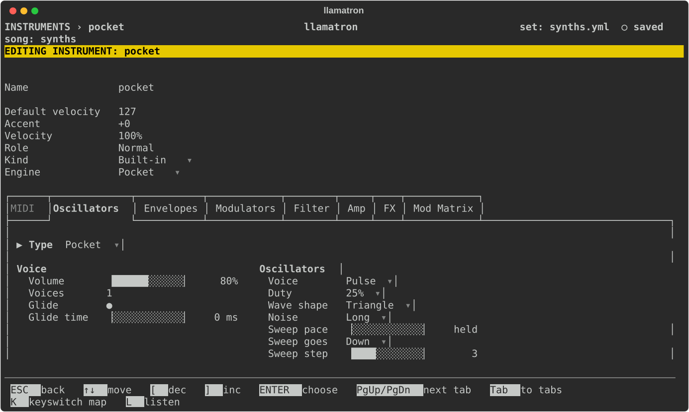

# Pocket

Pocket is one voice of a small 4-bit sound chip: a Pulse of one of four
duties, a drawn Wave of a few dozen 4-bit steps in one of five shapes, or
Noise, long or short, with a pitch sweep and the chip's stepped [Chip
steps](../ENVELOPES.md#chip-steps) envelope. It is the sound of small, bright
chip melodies and their chirps and zaps.

## How Pocket Is Built

The chip doesn't play a frequency; it counts down a period register from a
fixed clock, and a note's pitch is the nearest register value, so that its
tuning is the chip's own slightly crooked one. Each pulse duty and each drawn
wave is a single cycle made into band-limited tables: its harmonics measured
by one Fourier transform, then each octave's table keeping those under half
the sample rate. So a stepped wave keeps its steps right up to where they
would alias, and no further.

The noise is a shift register: its two lowest bits are combined by exclusive
or and fed back in at the top as it shifts, and each shift gives the next
value, high or low. Long noise uses the whole register, a hiss that hardly
repeats; short noise uses a short part of it, so it repeats quickly as a
metallic buzz.

The sweep moves the period register itself, as the chip does: at each tick of
its Sweep pace, the register is shifted right by its Sweep step and that
amount added or taken away, so that the pitch slides by a share of itself,
quickly at first. A sweep up that runs past the register's top silences the
voice, as on the chip.
