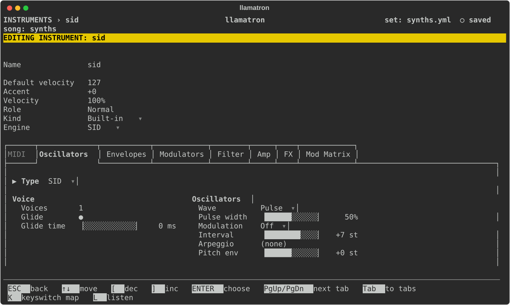

# SID

SID is one voice of an 8-bit sound chip: a Triangle, Saw, Pulse or Noise wave,
a pulse of a width, Ring or Sync from a second oscillator an Interval away,
and an Arpeggio of semitones stepped very fast, through the chip's own [SID
ADSR](../ENVELOPES.md#sid-adsr) envelope. It is the sound of fast arpeggiated
chords, buzzy sync leads and swept pulse basses.

## How SID Is Built

The saw and triangle are made as the chip makes them. The chip counts a phase
in a register, and its saw is the register's top bits, its triangle those bits
folded over by the highest one. Each word goes through the chip's
digital-to-analog converter, a ladder of resistors whose values are a little
mismatched and whose bottom rung is missing its end resistor, so the lowest
bits run together and the higher ones step unevenly. The waves come out
slightly bent and grainy, never the clean ramps of a textbook, and are then
band-limited into wavetables of their own. The pulse is a comparator on the
same count, so it stays clean: a pulse made every sample, its edges smoothed
by a polyBLEP. To sweep the width, as players sweep the chip's width in its programs,
route an LFO with a Triangle shape to Pulse width in the [Mod
Matrix](../MOD_MATRIX.md).

Noise is the chip's own: a shift register of many bits, its feedback taken
from two of its bits by exclusive or and fed back in at the top as the
register shifts, and its output an eight-bit word read from scattered bits of
the register and played through the same uneven converter. The register is
shifted once for each step of the note's cycle, so that the noise is pitched
by the note, from a low rumble to a high hiss. The register's run of values is
worked out once, when the program first needs it, and stepped through after.

Modulation brings in a second oscillator an Interval above. Ring flips the
sign of the wave whenever the second oscillator is in its second half, the
chip's ring modulation, a bell-like clang; the chip rings only its triangle,
and here every wave rings, which goes beyond the chip. With Sync the second oscillator
plays the note and the wave heard, tuned the Interval above it, restarts each
time the second completes its cycle: the note keeps its pitch, and the
Interval moves the bright, vocal peak inside it, the tearing lead of hard
sync, and a Mod Matrix route to SID interval sweeps that peak as the note
plays; each
restart falls between samples, and is smoothed there, a share in that sample
and a share in the next, so that a swept sync lead tears without the harsh
folding of a naive one. The
Arpeggio steps through its semitones at the speed the chip's programs ran,
once a frame of a television picture, which is how one chip voice plays a
whole chord.
